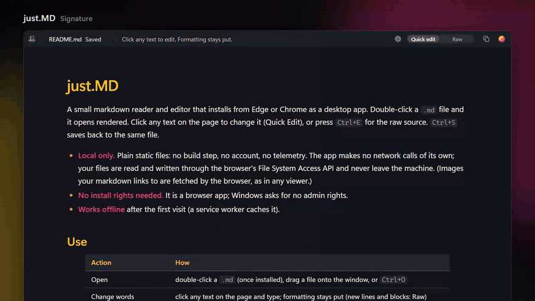

# just.MD

[](https://github.com/PavolKum/just.MD/actions/workflows/tests.yml)



A small markdown reader and editor that installs from Edge or Chrome as a desktop app.
Double-click a `.md` file and it opens rendered. Click any text on the page to change it
(Quick Edit), or press `Ctrl+E` for the raw source. `Ctrl+S` saves back to the same file.

- **Local only.** Plain static files: no build step, no account, no telemetry. The app makes no network
  calls of its own; your files are read and written through the browser's File System Access API and never
  leave the machine. (Images your markdown links to are fetched by the browser, as in any viewer.)
- **No install rights needed.** It is a browser app; Windows asks for no admin rights.
- **Works offline** after the first visit (a service worker caches it).

## Use

| Action | How |
|---|---|
| Open | double-click a `.md` (once installed), drag a file onto the window, or `Ctrl+O` |
| Change words | click any text on the page and type; formatting stays put (new lines and blocks: Raw) |
| Raw source | `Ctrl+E` (same place, both ways), or the Quick edit / Raw switch in the title strip |
| Commands | `Ctrl+K` or the gear icon: open, save, save as, Raw, Split, copy all, reload from disk, themes; shortcuts show beside each |
| Next / previous piece of text | `Tab` / `Shift+Tab`; `Ctrl+Enter` toggles a task; `Ctrl+click` opens a link |
| Undo / redo | `Ctrl+Z` / `Ctrl+Y` (one history for Quick Edit and Raw) |
| Save | `Ctrl+S` (writes the same file); `Ctrl+Shift+S` saves as |
| Copy all | the copy icon in the title strip, or the palette |
| Themes | Signature (dark), Light, Blackwall, Synthwave; `Ctrl+Shift+L` steps to the next one; remembered |
| Unsaved changes | pink dot and "Edited" in the title strip, `*` in the window title, warning on close |

Saving keeps the file's original line endings (CRLF or LF) and UTF-8 BOM. If another program
changes the open file, just.MD reloads it in place, or warns first when you have unsaved edits.

## Install

The installed app is tied to the address it was installed from, so pick one and keep it.

**A. Run it locally with Python**

```
python tools/serve.py            # serves this folder on http://127.0.0.1:8765/
python tools/serve.py --ensure   # start it in the background if it is not already running
```

Open `http://127.0.0.1:8765/` in Edge or Chrome, then install it (below). The server is only needed
for the first install and for picking up new versions; the app runs from its cache otherwise.
`serve.py` is a convenience for your own machine: it serves this whole folder on 127.0.0.1 only and
is not meant as a hosting server.

**B. No Python: the hand-out package**

`python tools/make_dist.py` builds `dist/just.MD.zip`: the app plus `serve.ps1`, a small PowerShell
server for localhost. Whoever receives the zip copies the folder, opens an AI coding agent (Claude Code
or similar) in it and says "please install this on my machine"; the agent follows
`package/INSTALL-FOR-CLAUDE.md`. Releases can carry the zip.

**C. Host it**

Any static https host works (GitHub Pages included); all paths are relative. Hosting changes the
privacy story only in that the app's code comes from that host; documents are still opened and
saved locally.

**Then, in the browser**

1. Click the "App available" / install icon in the address bar (Edge: `...` > Apps > Install this
   site as an app; Chrome: `...` > Cast, save and share > Install page as app).
2. If the browser asks whether just.MD may open markdown files, allow it.
3. Right-click any `.md` file > Open with > Choose another app > **just.MD** > **Always**.
4. The first save to each file asks for permission to edit it; choose "Allow on every visit" if offered.

On a managed PC, a browser policy may block app installs. The page still works in a normal tab:
`Ctrl+O` to open, `Ctrl+S` saves in place, just no double-click.

## Limits

- Relative links and images inside the markdown don't resolve: the app only has access to the one
  file it was given, not its folder.
- Quick Edit changes words only: it refuses edits that would change the markdown structure
  (new lines, headings, bold on/off, links, rows). Raw does everything else.
- Files over ~300 KB open in Raw.
- No Mermaid diagrams or maths.
- Built and tested on Windows 11 with Edge and Chrome. File handling and the title-strip layout
  (Window Controls Overlay) are Chromium desktop features; Firefox and Safari can't install it.

## Files

- `index.html`, `style.css`, `app.js` - the app; `engine.js` - the Quick Edit model (source offsets,
  re-parse verification, block patching)
- `manifest.webmanifest` - install metadata, including the `.md` file handler
- `sw.js` - offline cache (bump `VERSION` when the app changes, so installed copies update)
- `vendor/` - pinned copies of marked 18.1.3, DOMPurify 3.4.17 and highlight.js 11.12.0
  (see `THIRD_PARTY_NOTICES.md`)
- `icons/` - `icon.svg` is the source; `python tools/make_icons.py` renders the PNGs
- `tools/serve.py` - the local server; `tools/make_dist.py` - builds the hand-out package;
  `tools/screenshot.py` - renders `docs/screenshot.png` from `docs/screenshot.md`
- `tools/promo/` - records the README demo (`python tools/promo/make_promo.py`: MP4 plus `docs/demo.gif`)
- `.github/workflows/tests.yml` - runs the five test suites on Windows for every push
- `package/` - the hand-out package's own docs and `serve.ps1`

## Tests

The tests drive the real app in headless Chromium through Playwright:

```
python -m pip install playwright
python -m playwright install chromium

python tests/smoke.py            # render, sanitising, CRLF/BOM round-trip, saves, chrome, themes
python tests/test_quick_edit.py  # Quick Edit keystrokes, byte-level, plus broken builds that must fail
python tests/test_disk_watch.py  # reload / warn when the file changes on disk
python tests/test_perf.py        # <= 4 ms per keystroke at 100 KB
python tests/test_dist.py        # the hand-out package builds
```

## License

MIT, see `LICENSE`. The vendored libraries keep their own licenses (`THIRD_PARTY_NOTICES.md`).
